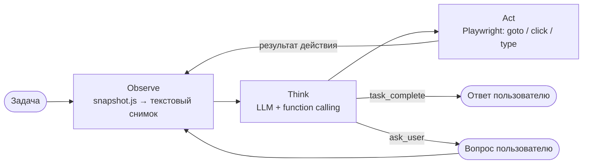

# web-agent — AI-агент для браузера

[](https://github.com/mellettan/ai_agent/actions/workflows/ci.yml)


Автономный агент, который выполняет задачи в настоящем браузере: «найди на hh.ru вакансии Python-разработчика в Москве с удалёнкой и выпиши три самые свежие». LLM видит упрощённый снимок страницы и через function calling выбирает следующее действие: перейти по ссылке, ввести текст, кликнуть, прокрутить, спросить пользователя или завершить задачу.

Работает с любым OpenAI-совместимым API: OpenAI, self-hosted модели через vLLM (Qwen, Llama), Ollama, LM Studio. Те же инструменты браузера доступны как **MCP-сервер** для Claude Desktop, Cursor и других MCP-клиентов.

## Как это работает



**Снимок страницы.** `snapshot.js` выполняется в странице и превращает DOM в компактный текст: URL, заголовки и только видимые интерактивные элементы с номером `bid`. Подпись ищется по `aria-label`, `<label for>`, обёртке `<label>`, placeholder и тексту; для полей видно текущее значение (кроме паролей), для чекбоксов — состояние, для списков — варианты.

```
[URL] https://hh.ru/search/vacancy?text=python
[Title] Работа Python-разработчиком в Москве

## Вакансии
[TextInput bid=0, label="Профессия, должность или компания", value="python"]
[Checkbox bid=1, label="Удалённая работа", unchecked]
[Link bid=2, label="Python-разработчик (Middle)"]
```

**Контекст не растёт бесконечно.** Снимки занимают большую часть токенов, поэтому полностью хранятся только два последних, а более старые заменяются строкой с URL. Размер контекста логируется на каждом шаге.

**Самокоррекция.** На каждый tool call модель получает ответ инструмента: успех, ошибка (элемента нет, таймаут) или пометка, что страница не изменилась. Неизвестные инструменты, невалидный JSON и ответы без вызова инструмента не роняют агента, а возвращаются модели как обратная связь. Аргументы валидируются pydantic-моделями, из которых же генерируются JSON Schema инструментов.

**Человек в контуре.** Для логина, капчи или подтверждения необратимых действий агент вызывает `ask_user` и ждёт ответа в терминале.

## Инструменты

| Инструмент | Что делает |
|---|---|
| `goto(url)` | открыть страницу |
| `click(bid)` | клик по элементу |
| `type_text(bid, text, submit)` | ввести текст, `submit` нажимает Enter |
| `select_option(bid, option)` | выбрать значение в списке |
| `scroll(direction)` | прокрутка вверх или вниз |
| `go_back()` | назад |
| `ask_user(question)` | спросить пользователя |
| `task_complete(success, summary)` | завершить задачу с ответом |

## Запуск

```bash
uv sync
uv run playwright install chromium
cp .env.example .env   # OPENAI_API_KEY или OPENAI_BASE_URL
uv run web-agent "открой python.org и найди дату выхода последней версии Python"
```

Параметры: `--headless`, `--max-steps 40`, `--model gpt-4.1-mini`. Профиль браузера хранится в `.browser/`, поэтому достаточно один раз залогиниться вручную, и агент будет работать под вашей сессией. Подробный лог каждого запуска пишется в `logs/`.

### Локальная модель через vLLM

```bash
vllm serve Qwen/Qwen3-8B --enable-auto-tool-choice --tool-call-parser hermes
```

```env
OPENAI_BASE_URL=http://localhost:8000/v1
LLM_MODEL=Qwen/Qwen3-8B
```

### MCP-сервер

`web-agent-mcp` запускает MCP-сервер по stdio с инструментами `snapshot`, `open_url`, `click`, `type_text`, `select_option`, `scroll`, `go_back`. Каждый инструмент возвращает результат действия вместе со свежим снимком страницы. Пример для Claude Desktop (`claude_desktop_config.json`):

```json
{
  "mcpServers": {
    "web-browser": {
      "command": "uv",
      "args": ["--directory", "/path/to/ai_agent", "run", "web-agent-mcp"]
    }
  }
}
```

## Разработка

```bash
uv sync
uv run playwright install chromium-headless-shell
uv run pytest
uv run ruff check . && uv run ruff format --check .
```

- `tests/test_agent.py` — цикл агента со скриптованной моделью и фейковым браузером: протокол tool calls, ошибки, лимит шагов, сворачивание снимков.
- `tests/test_browser.py` — настоящий headless Chromium на локальной HTML-странице: снимок и действия по `bid`.
- `tests/test_mcp.py` — инструменты MCP-сервера.

## Структура

```
src/web_agent/
├── agent.py        # цикл observe → think → act
├── browser.py      # async Playwright: снимок и действия по bid
├── snapshot.js     # DOM → компактный текст для LLM
├── tools.py        # pydantic-модели инструментов и JSON Schema
├── history.py      # история сообщений и экономия контекста
├── llm.py          # клиент OpenAI-совместимого API
├── prompts.py      # системный промпт
├── mcp_server.py   # MCP-сервер с инструментами браузера
├── config.py       # настройки (pydantic-settings)
└── __main__.py     # CLI
```
